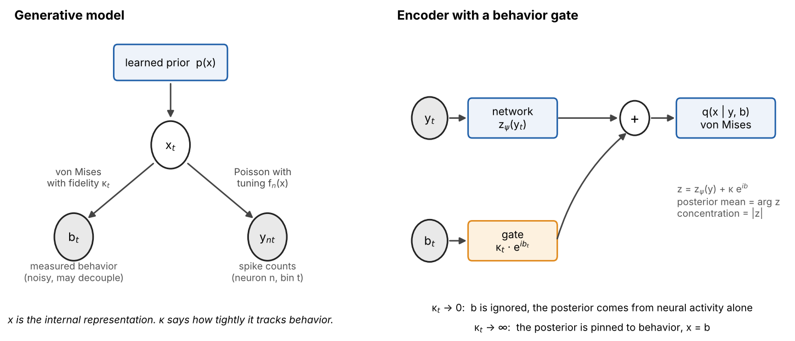
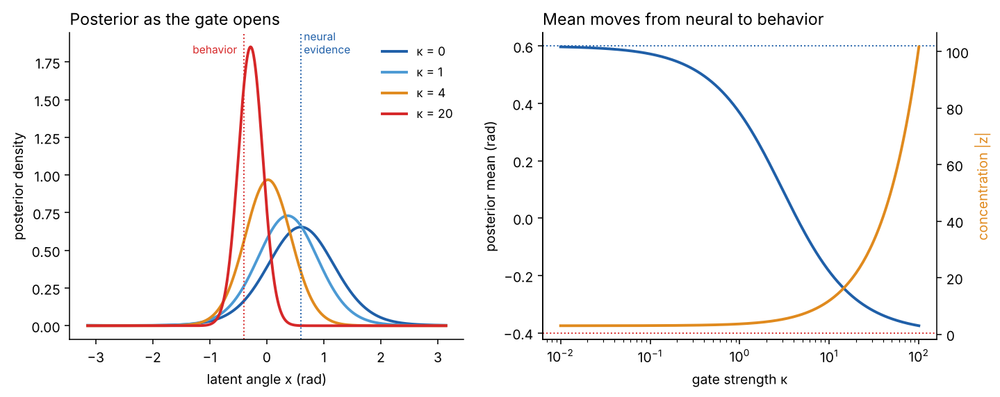
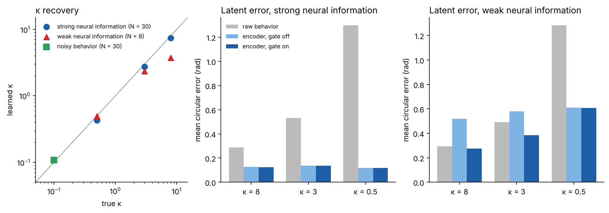
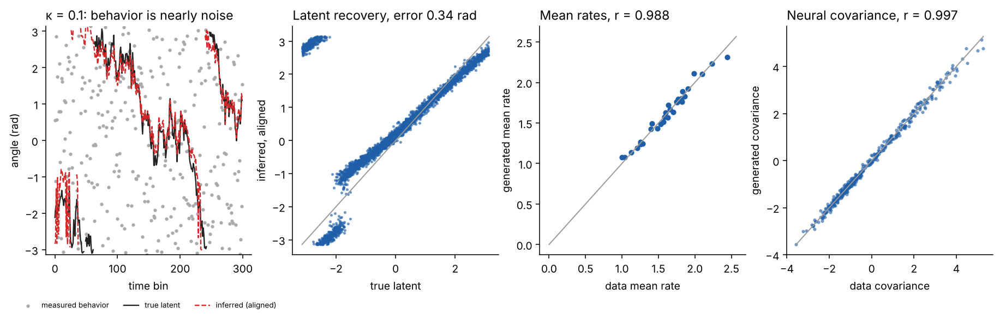
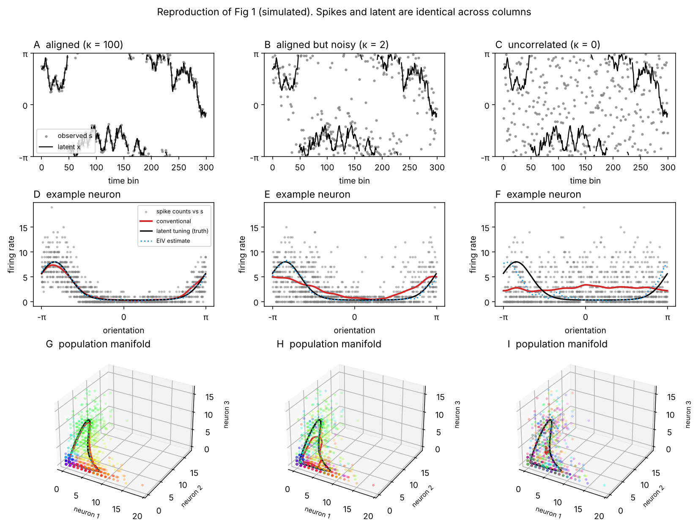
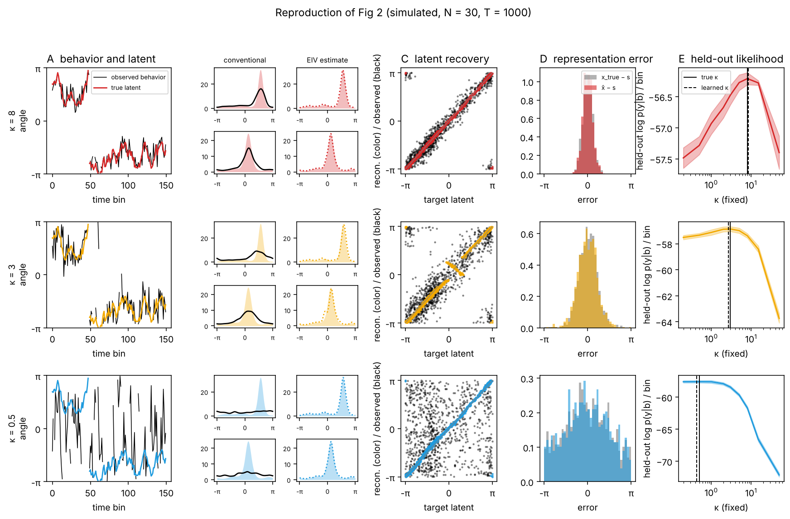
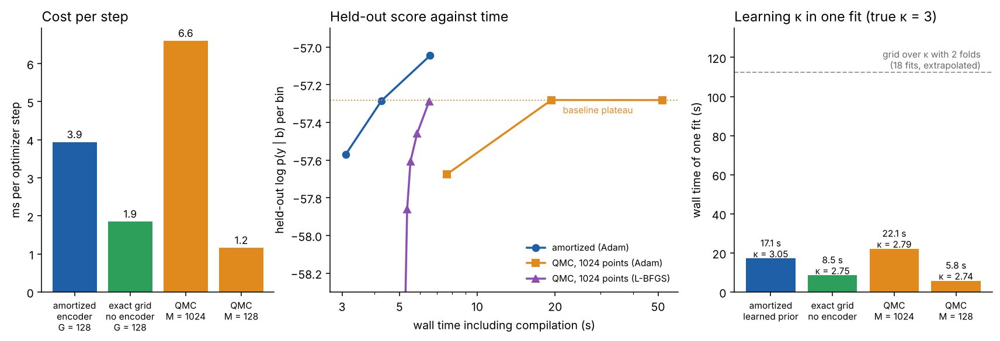
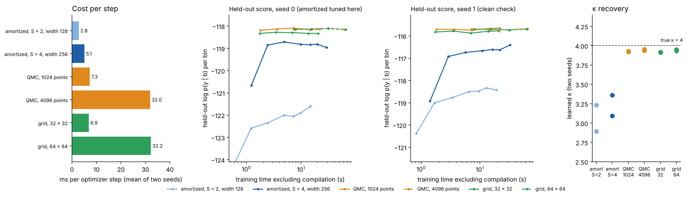

# amortized-eiv

Amortized error-in-variables (EIV) regression for neural population activity. The model infers a latent internal representation from neural activity and measured behavior, and learns how closely the two agree.

This is research code. All results so far are on simulated data. It follows the setup of Garon, Keeley, and Williams (bioRxiv 2026, doi 10.64898/2026.04.22.720005) and changes how the latent is inferred and how the coupling to behavior is estimated.

## The idea

Neuroscientists often fit tuning curves of neural activity against a measured sensory or behavioral variable b, such as heading direction. This treats b as noise-free. The internal representation x that the neurons actually encode can deviate from b, for example when sensory cues are removed or when tracking is noisy. When it does, conventional tuning curves flatten, and the loss of tuning looks like a change in the neurons when it is a change in how well x tracks b.

EIV regression models neural activity as tuned to a latent x, with behavior as a noisy observation of x. A fidelity parameter κ sets how tightly the two are coupled. Large κ gives conventional supervised tuning curves, and small κ gives an unsupervised latent variable model. The preprint chooses one κ per epoch by cross-validation and integrates over x by sampling.

This code makes three changes.

- An encoder infers x. It takes neural activity as input, and behavior enters through a gate set by κ, so the posterior is neural-only when behavior is noisy and pinned to behavior when it is reliable.
- κ is learned by gradient and can differ by condition, instead of being scanned over a grid.
- The prior on x is learned. When behavior is too noisy to constrain x, the fit is a generative model of neural activity with a learned prior.



| Regime | What the model is |
| --- | --- |
| κ → ∞ | Supervised tuning-curve model. The latent equals behavior. |
| intermediate κ | Partially supervised EIV, as in the preprint. |
| κ → 0 | Unsupervised latent variable model (VAE or GPLVM) with a learned prior. Behavior only aligns the latent afterward. |

## Model

```
x_t        ~ p_phi(x)                             learned prior on the ring
b_t | x_t  ~ VonMises(x_t, kappa_c(t))            behavior, one kappa per condition
y_nt | x_t ~ Poisson(exp(b_n + Phi(x_t) W_n))     Fourier-basis tuning, smoothness prior on W
q(x_t | y_t, b_t) = VM(arg z_t, |z_t|),   z_t = z_psi(y_t) + kappa_t * exp(i b_t)
```

The encoder combines the neural evidence z_psi(y) and the behavioral evidence kappa exp(ib) by adding their complex parameters, which is the exact product of two von Mises densities. The gate strength is κ. At κ = 0 the encoder decodes from neural activity alone, which is what sleep and immobility decoding need.



*Left: the posterior over x for fixed neural evidence at 0.6 rad and behavior at −0.4 rad, as the gate opens. Right: the posterior mean moves from the neural estimate to behavior as κ grows, and the posterior sharpens.*

The training objective is the ELBO on log p(y, b):

```
E_q[ log p(y | x) + kappa cos(b - x) - log 2 pi I0(kappa) ] - KL( q(x | y, b) || p_phi(x) )
```

The behavior term depends on q through its first circular moment, which gives the update for κ:

```
I1(kappa) / I0(kappa) = mean over t of  rho_t cos(b_t - mu_t),     rho_t e^{i mu_t} = E_q[e^{ix}]
```

The right side is small when the posterior is broad or displaced from behavior. Then κ goes to 0, p(x | b) goes to the prior, and behavior has no gradient on x. Training randomly zeroes the encoder gate in a fraction of bins. The generative model is unchanged, so the ELBO stays a valid bound.

On the ring the latent lives on a grid of 128 points, so the ELBO is an exact sum. On the 2D torus the posterior is Gaussian and the ELBO uses reparameterized samples.

## Results so far

- κ and the latent are recovered on simulated ring data. Learned κ is within 15% of the truth in the strong-information ring test.
- The preprint's simulated examples (Fig 1 and Fig 2) are reproduced, including the held-out likelihood peak at the true κ.
- The gate helps where behavior is informative and has no effect where it is noisy.
- When behavior is nearly noise, the fit reproduces the neural mean rates and covariance.
- In one dimension the amortized model is not faster, except that learning κ in one fit is about 6 times cheaper than a grid over κ with folds. Baselines can learn κ too.
- In a 2D latent the amortized model is cheaper per step but fits worse and underestimates κ.

### Recovery on simulated ring data



Simulated ring data, 3000 steps, seed 0. Errors are the mean circular error of the posterior mean against the true latent, in radians. With strong neural information (N = 30) the latent error is 0.12 to 0.14 rad in every condition, against 0.29 to 1.30 rad for raw behavior.

| Condition | κ true | κ learned | Latent error | Raw behavior error |
| --- | --- | --- | --- | --- |
| 0 | 8.0 | 7.40 | 0.12 | 0.29 |
| 1 | 3.0 | 2.75 | 0.14 | 0.53 |
| 2 | 0.5 | 0.43 | 0.12 | 1.30 |

With weak neural information (N = 8, low rates), the gate helps where behavior is informative and has no effect where it is not. κ is underestimated for the cleanest condition (3.72 against 8.0).

| Condition | κ true | κ learned | Gate on | Gate off | Raw behavior |
| --- | --- | --- | --- | --- | --- |
| 0 | 8.0 | 3.72 | 0.27 | 0.52 | 0.29 |
| 1 | 3.0 | 2.36 | 0.39 | 0.58 | 0.49 |
| 2 | 0.5 | 0.49 | 0.61 | 0.61 | 1.28 |

### Noisy behavior gives a generative model of neural activity



One condition with κ = 0.1 and T = 3000. The learned κ is 0.108. The latent is recovered up to rotation and reflection with an aligned error of 0.34 rad, against 1.55 rad for raw behavior (the cluster at the wrap-around of ±π in the second panel is the same trajectory seen across the circle boundary). Samples from the fitted model, drawn from the learned prior with behavior ignored, match the data in per-neuron mean rate (r = 0.988) and in neural covariance (r = 0.997).

### Reproducing the preprint's simulated examples

Both examples use simulated data, with spikes and latent identical across settings and only the behavior trace changing, as in the preprint. The ADn and grid-cell recordings are not reproduced.

Fig 1 (aligned, noisy, and uncorrelated behavior; N = 30, T = 1000). Conventional tuning curves (red) flatten as behavior noise grows, while tuning to the latent stays sharp and the population manifold is recovered. Latent errors are aligned for rotation and reflection.



| True κ | Learned κ | Aligned latent error (rad) | Raw behavior error (rad) |
| --- | --- | --- | --- |
| 100 | 80.6 | 0.06 | 0.08 |
| 2 | 2.04 | 0.11 | 0.66 |
| 0 (uniform) | 0.11 | 0.39 | 1.57 |

Fig 2 (κ = 8, 3, and 0.5; N = 30, T = 1000, tuning drawn from a periodic GP). Held-out log p(y | b) is computed on random held-out bins with κ fixed on a 9-point grid, following the preprint's protocol. The learned κ comes from a separate fit in which κ is free.



| True κ | Learned κ | Best grid κ | Latent error (rad) | Raw behavior error (rad) | Tuning r, EIV | Tuning r, conventional |
| --- | --- | --- | --- | --- | --- | --- |
| 8 | 8.53 | 8 | 0.054 | 0.28 | 0.996 | 0.961 |
| 3 | 2.70 | 3 | 0.129 | 0.53 | 0.915 | 0.878 |
| 0.5 | 0.43 | 0.5 | 0.088 | 1.31 | 0.988 | 0.659 |

The tuning peak-to-trough amplitude is 14.1 for the true curves, 14.2 to 14.3 for the EIV estimate, and 9.7, 6.8, and 2.3 for conventional tuning at κ = 8, 3, and 0.5. Differences from the preprint's protocol: the tuning prior is a periodic squared-exponential GP with length scale 0.12 of the period, not the preprint's exact kernel. Held-out scoring uses 2 folds and 1200 training steps per grid point, not 10 folds. There is one seed. For κ = 0.5 the held-out curve is flat below about 1, so the grid argmax of 0.5 is within noise of its neighbors, as in the preprint's bottom panel.

### Speed in one dimension



Measured on one CPU thread with T_train = 800, N = 30, and true κ = 3. The comparison baselines are stand-ins written for these tests, not the preprint's code. They use the same decoder with no encoder, and integrate the latent with quasi-Monte Carlo points from a Roberts sequence or with an exact sum on a grid. Left: cost per optimizer step. Middle: held-out score against wall time at fixed κ, including compilation. Right: wall time of one fit in which κ is learned, with the preprint's grid protocol (9 values of κ and 2 folds, 18 fits) extrapolated from one fit.

Held-out log p(y | b) per bin against training time at fixed κ, one random fold, Adam for all rows:

| Method | Steps | Wall time (s) | Train | Held-out |
| --- | --- | --- | --- | --- |
| Amortized | 300 | 3.1 | −56.44 | −57.57 |
| Amortized | 600 | 4.3 | −56.08 | −57.29 |
| Amortized | 1200 | 6.6 | −55.71 | −57.05 |
| Quasi-Monte Carlo, M = 1024 | 1200 | 7.6 | −56.25 | −57.68 |
| Quasi-Monte Carlo, M = 1024 | 4000 | 19.4 | −55.64 | −57.28 |
| Quasi-Monte Carlo, M = 1024 | 10000 | 52.1 | −55.64 | −57.28 |
| Exact grid marginal, optimized directly | 4000 | | −55.65 | −57.28 |

- The amortized model is not faster in this setting. Per step it is cheaper than 1024-point sampling only because it uses 128 grid points. In one dimension the grid marginal is exact, so the encoder roughly doubles the cost per step and is not needed for the likelihood. The run-to-run variation of these timings is about a factor of 1.7 for the 1024-point baseline.
- Learning κ jointly is about 6 times cheaper than the grid with folds. The baselines can also learn κ, in 5.8 to 22 s, so this saving does not come from amortization. The amortized fit is the slowest of the four, and its κ (3.05) and held-out score (−57.09) are the best. The baselines give κ between 2.74 and 2.79 and held-out scores between −57.24 and −57.33.
- The convergence advantage over the Adam baseline is small against a better optimizer. With L-BFGS the baseline reaches held-out −57.29 in 320 iterations. That is about 1.3 s of compute (4.1 ms per iteration), plus about 4 s of compilation. Amortized Adam reaches −57.29 in 600 steps, which is about 2.4 s of compute and 4.3 s including compilation. The ranking depends on whether compilation is counted.
- The baseline's plateau at −57.28 is not a sampling artifact. Optimizing the exact grid marginal directly gives the same train and held-out scores. The amortized ELBO fit has a slightly worse train score (−55.71) and a better held-out score (−57.05), so it generalizes better on this fold. The mechanism is not tested. The learned prior is not the cause (held-out −57.05 with it and −57.03 without).

### Two-dimensional latent



The one-dimensional ring is the easy case for integration, so this test uses a torus latent. N = 60 neurons, T = 2000 bins (1600 train, 400 held-out), true κ = 4 on each axis, a 2D Fourier-basis decoder with 24 frequencies, a uniform prior, minibatch 512, Adam, and κ learned by gradient for every method. The amortized model uses a Gaussian posterior with reparameterized samples, so its cost per step does not depend on the number of integration points. The baselines integrate with quasi-Monte Carlo points or an exact grid. Every method is scored with the same fixed 96 × 96 grid, and every method starts from the same supervised Poisson fit of tuning curves to behavior, as the preprint does. Without that initialization, the three methods that finished in an aborted first run ended with learned κ near 1 and latent error of 0.7 to 1.0 rad. Training times exclude compilation and evaluation.

Two data seeds. The first amortized configuration (S = 4 samples, width 256) was chosen by looking at seed 0's held-out score, so seed 0 is tuned for it and seed 1 is a clean check. Entries are seed 0 / seed 1.

| Method | ms per step | Held-out log p(y given b) | Learned κ (true 4) | Latent error (rad) |
| --- | --- | --- | --- | --- |
| Amortized, S = 2, width 128 | 2.5 / 3.2 | −121.61 / −118.43 | 2.89 / 3.23 | 0.136 / 0.113 |
| Amortized, S = 4, width 256 | 4.9 / 5.4 | −118.96 / −116.41 | 3.09 / 3.36 | 0.071 / 0.055 |
| QMC, M = 1024 | 7.3 / 7.3 | −118.14 / −115.65 | 3.93 / 3.92 | 0.043 / 0.047 |
| QMC, M = 4096 | 31.5 / 32.4 | −118.16 / −115.68 | 3.94 / 3.95 | 0.047 / 0.044 |
| Exact grid, 32 × 32 | 6.9 / 7.0 | −118.33 / −115.77 | 3.91 / 3.92 | 0.064 / 0.060 |
| Exact grid, 64 × 64 | 33.1 / 31.4 | −118.15 / −115.69 | 3.93 / 3.95 | 0.047 / 0.047 |

Raw behavior has a mean error of 0.43 rad on the held-out bins. Latent error is the exact-posterior mean under each method's own fitted decoder and κ. Steps were 6000 for the amortized models, 3000 for the 1024-point baselines, and 2000 for the 4096-point baselines.

- The amortized model is cheaper per step: 2.5 to 5.4 ms against 7 ms for 1024 points and 31 to 33 ms for 4096 points.
- It does not match the baselines' fit. The larger encoder is about 0.8 nats per bin worse on held-out score on both seeds, and the smaller one is 2.8 to 3.5 worse. The baselines come within 0.5 nats of their best score in 1.7 to 1.8 s (1024 points) or 7 to 8 s (4096 points). The amortized model does not get there in 6000 steps.
- Learned κ is biased low, 2.9 to 3.4 against a true 4, while all four integrator baselines recover 3.9 to 3.95. The encoder's own latent error (0.18 to 0.31 rad) is far above the exact posterior's (0.04 to 0.07). This is the amortization gap, and it pulls κ down as the derivation above predicts.
- 1024 points are already enough in 2D (a 32 × 32 grid is within 0.2 nats of 64 × 64), so integration is not the bottleneck yet. The expected crossover is at higher dimension, where a 3D latent needs about 32 times the points at the same resolution. That case is untested.

## Known limitations

- κ is biased low when neural information is weak. With N = 8 the cleanest condition gives 3.7 against a true 8, and a 9000-step run stays near 3.8, so this is not slow convergence. The cause is not isolated. A broad posterior pulls the κ update down, which fits the mechanism above, but this is a hypothesis.
- With strong neural information the cleanest condition is 7.4 at 3000 steps and still rising slowly.
- In the κ = 3 reproduction, 5% of bins (latent between about −0.2 and 1.05 rad, a sparsely visited stretch) are mislocated by more than 0.5 rad. The latent is warped over that stretch. This is plausibly a local optimum and was not investigated.
- In the uncorrelated case (κ = 0) the latent is identified only up to rotation and reflection, and a residual warp remains after alignment (0.39 rad).
- Simulated data only. Fig 2 and the 2D benchmark draw tuning curves from the decoder's own Fourier family, which favors the model. The smoke tests and Fig 1 use von Mises bump tuning.
- Not compared against the authors' code, which is not public as far as I could find. The preprint refers to "the software package" without a link. The speed comparisons use stand-in baselines, and an L-BFGS baseline was tried. The preprint's own implementation was not.
- The speed results are from one dataset, one fold, and a one-dimensional latent. In the 2D torus the amortized model was cheaper per step but did not match the integrators' fit quality or recover κ. Latents of three or more dimensions are untested.
- One κ per condition. There is no within-condition drift, no dynamical prior, and no multi-region coupling. The ring latent is a grid of 128 points, a fixed approximation.

## Reproduce

```
pip install -e ".[dev]"
pytest -q                               # about 2 minutes on one CPU
python scripts/smoke_test.py            # strong, weak, and noisy-behavior ring tests (JSON)
python scripts/fig1_conceptual.py       # Fig 1 reproduction, about 3 minutes
python scripts/fig2_validation.py       # Fig 2 reproduction, about 12 minutes
python scripts/benchmark_speed.py       # ring speed benchmark
python scripts/convergence_diagnostics.py
python scripts/lbfgs_baseline.py
python scripts/benchmark_torus2d.py     # 2D torus benchmark, about 11 minutes
python scripts/make_figures.py          # rebuild figures/ from the saved results
```

```python
import amortized_eiv as ae
d = ae.simulate(kappas=(8.0, 3.0, 0.5))
params, cfg, stats, feat, hist = ae.fit(d["y"], d["b"], d["cond"], n_cond=3)
mu, rho, q = ae.posterior(params, cfg, feat, d["b"], d["cond"])                    # with behavior
mu0, rho0, _ = ae.posterior(params, cfg, feat, d["b"], d["cond"], use_behavior=False)
```

| Path | Contents |
| --- | --- |
| `amortized_eiv/model.py` | Ring model, ELBO, encoder with gate |
| `amortized_eiv/torus2d.py` | 2D torus model and the three fitting methods |
| `amortized_eiv/baseline.py` | Quasi-Monte Carlo and exact-grid baselines |
| `amortized_eiv/experiments.py`, `simulate.py` | Experiments and simulators |
| `tests/` | Derivation checks, smoke tests, simulator tests, 2D tests |
| `results/` | Saved results, logs, and the Fig 1 and Fig 2 reproductions |
| `figures/` | Figures used in this README |
