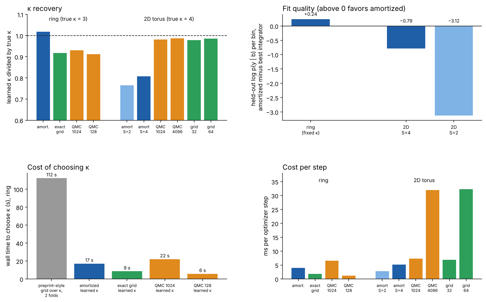
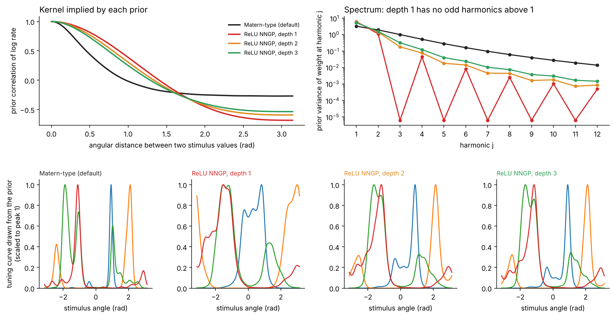
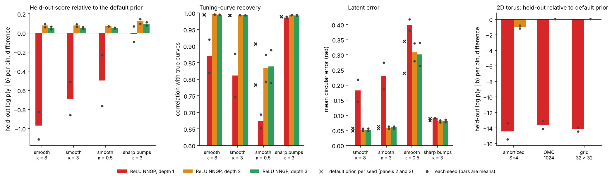
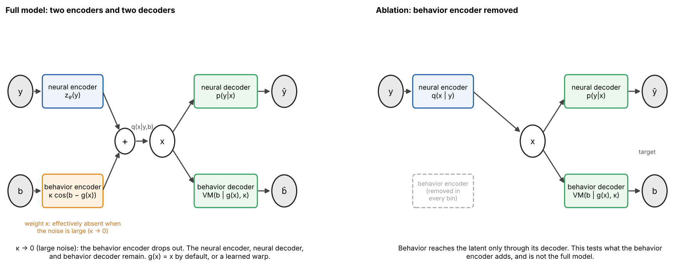
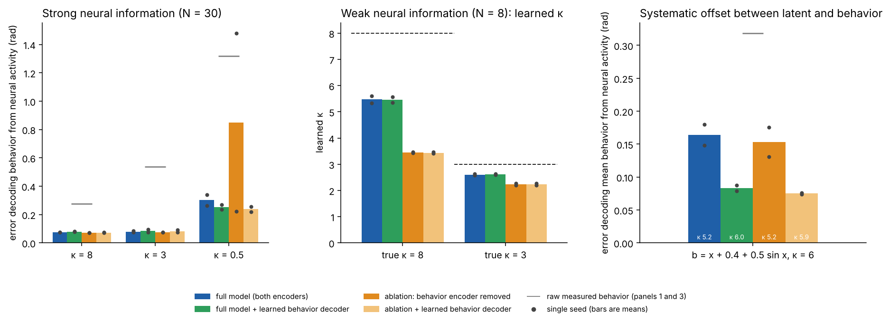

# amortized-eiv

Amortized error-in-variables (EIV) regression for neural population activity. It is an encoder-based variant of the model in Garon, Keeley, and Williams, "Tracking the Fidelity of Internal Neural Representations with Error-In-Variables Regression" (bioRxiv 2026, doi 10.64898/2026.04.22.720005). This is research code, and all results so far are on simulated data.

## The idea

### The problem, and the preprint's answer

Tuning curves are usually fit against a measured behavioral variable b, such as heading direction, as if b were exact. The representation x that the neurons carry can differ from b, for example when sensory cues are removed, when tracking is noisy, or when path integration drifts. Conventional tuning curves then flatten. The flattening looks like a change in the neurons, when it is a change in how well x tracks b.

The preprint models this directly. The latent is x = b + ε, where ε is von Mises noise with concentration κ. (The preprint writes the noise on either side, x = s + ε in its Results and s = x + ε in its Methods. Von Mises noise is symmetric, so the two agree.) Spikes are Poisson with tuning curves f_n(x) that have a Gaussian-process prior, written as a Fourier expansion. The concentration κ measures how faithfully x tracks b. Large κ gives the conventional tuning-curve model, and small κ gives an unsupervised latent variable model (a GPLVM). The preprint chooses κ for each epoch from a grid by cross-validated likelihood, and it integrates over x by quasi-Monte Carlo sampling or a particle filter. It applies the model to head-direction cells in mouse anterodorsal thalamus and to grid cells in rat entorhinal cortex.

### This code: the same model, with an encoder and a learned noise scale

The generative model is the preprint's: x = b + noise, then neural activity. Two limits show how it interpolates.

- No noise (K = 0). Then x = b, and the model is the conventional supervised tuning-curve fit.
- Large noise. The noise swamps b. The neural encoder, the neural decoder, and a prior on x that is learned from neural activity then determine x. Behavior no longer constrains it, and the model is a neural latent variable model.

K is the noise scale. The code uses the von Mises concentration κ, which is about 1 / K² for small noise, so large noise corresponds to small κ.


Behavior enters through the conditional prior p(x | b). It is b plus noise, renormalized by a prior p(x) that is learned from neural activity. As the noise grows, p(x | b) reduces to p(x), and the neural encoder q(x | y) and neural decoder p(y | x) do the rest. When both neural activity and behavior are available, the posterior over x is the product of the neural evidence and the behavior term. Both are von Mises, so they multiply by adding their complex parameters, with behavior weighted by κ. This is not a separate gate. The "gate" in the code, and the `p_drop` option, is this weight κ on the behavior term in the encoder.

This code changes three things from the preprint. An encoder infers x instead of sampling over it. The noise scale is learned by gradient, one value per condition, instead of being chosen on a grid. The prior on x is learned instead of being uniform. Two options go further. A learned map from the latent to behavior handles systematic offsets between x and b, and a different tuning prior (an infinitely wide network kernel) can replace the Matérn-type default.

| Noise scale K | Concentration κ | What the model is |
| --- | --- | --- |
| K = 0 | κ → ∞ | Supervised tuning-curve model. The latent equals behavior. This is the preprint's conventional analysis. |
| intermediate | intermediate | Partially supervised EIV, as in the preprint. |
| K large | κ → 0 | Neural latent variable model (VAE or GPLVM) with a learned prior. Behavior only aligns the latent afterward. |

## Model

```
x_t | b_t  ~ p_phi(x) VM(x; b_t, kappa_c(t)) / Z(b_t)    b plus noise, renormalized by the learned prior
y_nt | x_t ~ Poisson(exp(b_n + Phi(x_t) W_n))            neural decoder: Fourier-basis tuning, smoothness prior on W
q(x_t | y_t, b_t) = VM(arg z_t, |z_t|),  z_t = z_psi(y_t) + kappa_t * exp(i b_t)      encoder: neural evidence + behavior term
```

Here Z(b) is the integral of p_phi(x) VM(x; b, kappa) over x. The same model can be written the other way, with a prior p(x) and behavior generated from the latent, b | x ~ VM(x, κ). That form has the joint p(x) VM(b | x, κ) p(y | x). The two forms differ only by Z(b), which is constant for a flat prior. At κ = 0 the encoder decodes from neural activity alone, which is what sleep and immobility decoding need.


*Left: the posterior over x for fixed neural evidence at 0.6 rad and behavior at −0.4 rad, as the weight κ on behavior grows. Right: the posterior mean moves from the neural estimate to behavior as κ grows, and the posterior sharpens.*

The default training objective is the ELBO on log p(y, b), which models behavior as well:

```
E_q[ log p(y | x) + kappa cos(b - x) - log 2 pi I0(kappa) ] - KL( q(x | y, b) || p_phi(x) )
```

The conditional objective, `Config(objective="conditional")`, subtracts log Z(b) and so is the ELBO on log p(y | b). The two are identical for a flat prior and are compared below. The behavior term depends on q through its first circular moment, which gives the update for κ:

```
I1(kappa) / I0(kappa) = mean over t of  rho_t cos(b_t - mu_t),     rho_t e^{i mu_t} = E_q[e^{ix}]
```

The right side is small when the posterior is broad or displaced from behavior. Then κ goes to 0, p(x | b) goes to the learned prior, and behavior has no gradient on x. Training randomly omits the behavior term from the encoder in a fraction of bins (`p_drop`). The generative model is unchanged, so the ELBO stays a valid bound, and the neural path stays accurate for decoding without behavior.

The tuning-curve weights have a Gaussian prior whose spectrum sets the smoothness of the curves, which is the weight-space form of a Gaussian process. The default is Matérn-type. An infinitely wide ReLU network kernel is available as an option and is compared below.

On the ring the latent lives on a grid of 128 points, so the ELBO is an exact sum. On the 2D torus the posterior is Gaussian and the ELBO uses reparameterized samples.

## Results so far

- κ and the latent are recovered on simulated ring data. Learned κ is within 15% of the truth in the strong-information ring test.
- The preprint's simulated examples (Fig 1 and Fig 2) are reproduced, including the held-out likelihood peak at the true κ.
- Giving the encoder behavior helps where behavior is informative and has no effect where it is noisy.
- When behavior is nearly noise, the fit reproduces the neural mean rates and covariance.
- In one dimension the amortized model is not faster, except that learning κ in one fit is about 6 times cheaper than a grid over κ with folds. Baselines can learn κ too.
- In a 2D latent the amortized model is cheaper per step but fits worse and underestimates κ.
- The joint objective, which also models behavior, learns a sharper prior and a better κ than the conditional objective when the latent occupies a small part of the ring. They agree otherwise.
- Removing the behavior encoder costs κ accuracy with weak neural information. A learned behavior decoder, with both encoders kept, recovers κ and decodes behavior when behavior is offset from the latent.
- Replacing the Matérn-type tuning prior with an infinitely wide ReLU network kernel (NNGP) brings no gain over a smoother Matérn prior. Depth 1 fails when tuning curves have energy at odd harmonics above 1.



*The baseline is a stand-in written for these tests (same decoder, quasi-Monte Carlo or exact-grid integration of the latent), not the preprint's code. Top left: learned κ divided by the true value. Top right: held-out score of the amortized model minus the best integrator baseline. Bottom left: wall time to choose κ on the ring, with the preprint's grid protocol (9 values, 2 folds) extrapolated from one fit. Bottom right: cost per optimizer step. The 1024-point quasi-Monte Carlo step measured 3.8 ms in an earlier run, so timings vary by run.*

### Recovery on simulated ring data


Simulated ring data, 3000 steps, seed 0. Errors are the mean circular error of the posterior mean against the true latent, in radians. With strong neural information (N = 30) the latent error is 0.12 to 0.14 rad in every condition, against 0.29 to 1.30 rad for raw behavior.

| Condition | κ true | κ learned | Latent error | Raw behavior error |
| --- | --- | --- | --- | --- |
| 0 | 8.0 | 7.40 | 0.12 | 0.29 |
| 1 | 3.0 | 2.75 | 0.14 | 0.53 |
| 2 | 0.5 | 0.43 | 0.12 | 1.30 |

With weak neural information (N = 8, low rates), giving the encoder behavior helps where behavior is informative and has no effect where it is not. κ is underestimated for the cleanest condition (3.72 against 8.0).

| Condition | κ true | κ learned | With behavior | Neural activity only | Raw behavior |
| --- | --- | --- | --- | --- | --- |
| 0 | 8.0 | 3.72 | 0.27 | 0.52 | 0.29 |
| 1 | 3.0 | 2.36 | 0.39 | 0.58 | 0.49 |
| 2 | 0.5 | 0.49 | 0.61 | 0.61 | 1.28 |

### Noisy behavior gives a generative model of neural activity


One condition with κ = 0.1 and T = 3000. The learned κ is 0.108. The latent is recovered up to rotation and reflection with an aligned error of 0.34 rad, against 1.55 rad for raw behavior (the cluster at the wrap-around of ±π in the second panel is the same trajectory seen across the circle boundary). Samples from the fitted model, drawn from the learned prior with behavior ignored, match the data in per-neuron mean rate (r = 0.988) and in neural covariance (r = 0.997).

### Reproducing the preprint's simulated examples

Both examples use simulated data, with spikes and latent identical across settings and only the behavior trace changing, as in the preprint. The ADn and grid-cell recordings are not reproduced.

Fig 1 (aligned, noisy, and uncorrelated behavior; N = 30, T = 1000). Conventional tuning curves (red) flatten as behavior noise grows, while tuning to the latent stays sharp and the population manifold is recovered. Latent errors are aligned for rotation and reflection.


| True κ | Learned κ | Aligned latent error (rad) | Raw behavior error (rad) |
| --- | --- | --- | --- |
| 100 | 80.6 | 0.06 | 0.08 |
| 2 | 2.04 | 0.11 | 0.66 |
| 0 (uniform) | 0.11 | 0.39 | 1.57 |

Fig 2 (κ = 8, 3, and 0.5; N = 30, T = 1000, tuning drawn from a periodic GP). Held-out log p(y | b) is computed on random held-out bins with κ fixed on a 9-point grid, following the preprint's protocol. The learned κ comes from a separate fit in which κ is free.


| True κ | Learned κ | Best grid κ | Latent error (rad) | Raw behavior error (rad) | Tuning r, EIV | Tuning r, conventional |
| --- | --- | --- | --- | --- | --- | --- |
| 8 | 8.53 | 8 | 0.054 | 0.28 | 0.996 | 0.961 |
| 3 | 2.70 | 3 | 0.129 | 0.53 | 0.915 | 0.878 |
| 0.5 | 0.43 | 0.5 | 0.088 | 1.31 | 0.988 | 0.659 |

The tuning peak-to-trough amplitude is 14.1 for the true curves, 14.2 to 14.3 for the EIV estimate, and 9.7, 6.8, and 2.3 for conventional tuning at κ = 8, 3, and 0.5. Differences from the preprint's protocol: the tuning prior is a periodic squared-exponential GP with length scale 0.12 of the period, not the preprint's exact kernel. Held-out scoring uses 2 folds and 1200 training steps per grid point, not 10 folds. There is one seed. For κ = 0.5 the held-out curve is flat below about 1, so the grid argmax of 0.5 is within noise of its neighbors, as in the preprint's bottom panel.

### Speed in one dimension


Measured on one CPU thread with T_train = 800, N = 30, and true κ = 3. The comparison baselines are stand-ins written for these tests, not the preprint's code. They use the same decoder with no encoder, and integrate the latent with quasi-Monte Carlo points from a Roberts sequence or with an exact sum on a grid. Left: cost per optimizer step. Middle: held-out score against wall time at fixed κ, including compilation. Right: wall time of one fit in which κ is learned, with the preprint's grid protocol (9 values of κ and 2 folds, 18 fits) extrapolated from one fit.

Held-out log p(y | b) per bin against training time at fixed κ, one random fold, Adam for all rows:

| Method | Steps | Wall time (s) | Train | Held-out |
| --- | --- | --- | --- | --- |
| Amortized | 300 | 3.1 | −56.44 | −57.57 |
| Amortized | 600 | 4.3 | −56.08 | −57.29 |
| Amortized | 1200 | 6.6 | −55.71 | −57.05 |
| Quasi-Monte Carlo, M = 1024 | 1200 | 7.6 | −56.25 | −57.68 |
| Quasi-Monte Carlo, M = 1024 | 4000 | 19.4 | −55.64 | −57.28 |
| Quasi-Monte Carlo, M = 1024 | 10000 | 52.1 | −55.64 | −57.28 |
| Exact grid marginal, optimized directly | 4000 | | −55.65 | −57.28 |

- The amortized model is not faster in this setting. Per step it is cheaper than 1024-point sampling only because it uses 128 grid points. In one dimension the grid marginal is exact, so the encoder roughly doubles the cost per step and is not needed for the likelihood. The run-to-run variation of these timings is about a factor of 1.7 for the 1024-point baseline.
- Learning κ jointly is about 6 times cheaper than the grid with folds. The baselines can also learn κ, in 5.8 to 22 s, so this saving does not come from amortization. The amortized fit is the slowest of the four, and its κ (3.05) and held-out score (−57.09) are the best. The baselines give κ between 2.74 and 2.79 and held-out scores between −57.24 and −57.33.
- The convergence advantage over the Adam baseline is small against a better optimizer. With L-BFGS the baseline reaches held-out −57.29 in 320 iterations. That is about 1.3 s of compute (4.1 ms per iteration), plus about 4 s of compilation. Amortized Adam reaches −57.29 in 600 steps, which is about 2.4 s of compute and 4.3 s including compilation. The ranking depends on whether compilation is counted.
- The baseline's plateau at −57.28 is not a sampling artifact. Optimizing the exact grid marginal directly gives the same train and held-out scores. The amortized ELBO fit has a slightly worse train score (−55.71) and a better held-out score (−57.05), so it generalizes better on this fold. The mechanism is not tested. The learned prior is not the cause (held-out −57.05 with it and −57.03 without).

### Two-dimensional latent


The one-dimensional ring is the easy case for integration, so this test uses a torus latent. N = 60 neurons, T = 2000 bins (1600 train, 400 held-out), true κ = 4 on each axis, a 2D Fourier-basis decoder with 24 frequencies, a uniform prior, minibatch 512, Adam, and κ learned by gradient for every method. The amortized model uses a Gaussian posterior with reparameterized samples, so its cost per step does not depend on the number of integration points. The baselines integrate with quasi-Monte Carlo points or an exact grid. Every method is scored with the same fixed 96 × 96 grid, and every method starts from the same supervised Poisson fit of tuning curves to behavior, as the preprint does. Without that initialization, the three methods that finished in an aborted first run ended with learned κ near 1 and latent error of 0.7 to 1.0 rad. Training times exclude compilation and evaluation.

Two data seeds. The first amortized configuration (S = 4 samples, width 256) was chosen by looking at seed 0's held-out score, so seed 0 is tuned for it and seed 1 is a clean check. Entries are seed 0 / seed 1.

| Method | ms per step | Held-out log p(y given b) | Learned κ (true 4) | Latent error (rad) |
| --- | --- | --- | --- | --- |
| Amortized, S = 2, width 128 | 2.5 / 3.2 | −121.61 / −118.43 | 2.89 / 3.23 | 0.136 / 0.113 |
| Amortized, S = 4, width 256 | 4.9 / 5.4 | −118.96 / −116.41 | 3.09 / 3.36 | 0.071 / 0.055 |
| QMC, M = 1024 | 7.3 / 7.3 | −118.14 / −115.65 | 3.93 / 3.92 | 0.043 / 0.047 |
| QMC, M = 4096 | 31.5 / 32.4 | −118.16 / −115.68 | 3.94 / 3.95 | 0.047 / 0.044 |
| Exact grid, 32 × 32 | 6.9 / 7.0 | −118.33 / −115.77 | 3.91 / 3.92 | 0.064 / 0.060 |
| Exact grid, 64 × 64 | 33.1 / 31.4 | −118.15 / −115.69 | 3.93 / 3.95 | 0.047 / 0.047 |

Raw behavior has a mean error of 0.43 rad on the held-out bins. Latent error is the exact-posterior mean under each method's own fitted decoder and κ. Steps were 6000 for the amortized models, 3000 for the 1024-point baselines, and 2000 for the 4096-point baselines.

- The amortized model is cheaper per step: 2.5 to 5.4 ms against 7 ms for 1024 points and 31 to 33 ms for 4096 points.
- It does not match the baselines' fit. The larger encoder is about 0.8 nats per bin worse on held-out score on both seeds, and the smaller one is 2.8 to 3.5 worse. The baselines come within 0.5 nats of their best score in 1.7 to 1.8 s (1024 points) or 7 to 8 s (4096 points). The amortized model does not get there in 6000 steps.
- Learned κ is biased low, 2.9 to 3.4 against a true 4, while all four integrator baselines recover 3.9 to 3.95. The encoder's own latent error (0.18 to 0.31 rad) is far above the exact posterior's (0.04 to 0.07). This is the amortization gap, and it pulls κ down as the derivation above predicts.
- 1024 points are already enough in 2D (a 32 × 32 grid is within 0.2 nats of 64 × 64), so integration is not the bottleneck yet. The expected crossover is at higher dimension, where a 3D latent needs about 32 times the points at the same resolution. That case is untested.

### Swapping the tuning prior: an infinitely wide decoder

The decoder's prior on the tuning-curve weights is the weight-space form of a Gaussian process over the log tuning curve. The default has a Matérn-type spectrum, with prior standard deviation 2 (1 + (j / 3)²)⁻¹ at harmonic j. This section replaces it with the kernel of an infinitely wide ReLU network, the neural network Gaussian process (NNGP) kernel, to test whether a prior derived from an architecture helps. It is selected with `Config(kernel="nngp", depth=L)` on the ring and `train(..., kernel="nngp", depth=L)` on the torus.

The inputs are (cos x, sin x) on the ring and (cos x₁, sin x₁, cos x₂, sin x₂) / √2 on the torus. At depth 1 the kernel is the arc-cosine kernel, k(d) = (sin d + (π − d) cos d) / π, and deeper kernels follow from the standard recursion. The Fourier coefficients of the kernel give the prior variance of each harmonic. The spectrum is rescaled to the same total variance as the default, so the priors differ in shape and not in scale. This is the NNGP and not the neural tangent kernel. The latent x is learned, so the decoder's inputs move during training and the tangent kernel's fixed-feature regime does not apply.



*Top left: prior correlation of the log rate between two stimulus values. The NNGP kernels are broader and strongly anticorrelated at the antipode. Top right: prior variance by harmonic. Depth 1 puts no variance on odd harmonics from 3 upward, a known property of ReLU kernels that I confirmed numerically. Bottom: tuning curves drawn from each prior, scaled to peak 1.*

Setup (`scripts/kernel_comparison.py`, `scripts/kernel_torus2d.py`, about 15 minutes in total). On the ring, N = 30 and T = 1000, with 80% of the bins for training and 20% for scoring, kappa learned for 3000 steps, and 2 seeds. The smooth data are drawn from a periodic squared-exponential GP (the Fig 2 setup) with kappa = 8, 3, and 0.5. The sharp data are von Mises bumps with concentration 6 and kappa = 3. On the torus, the data, folds, and budgets are those of the 2D benchmark, for three of its methods. Entries are means over the two seeds.



*Left to right: held-out score relative to the default prior, tuning-curve correlation with the true curves, latent error, and held-out score on the 2D torus. Bars are means over two seeds, dots are single seeds, and crosses are the default prior.*

| Data, true κ | Prior | κ learned | Held-out log p(y given b) | Tuning-curve r | Latent error (rad) |
| --- | --- | --- | --- | --- | --- |
| smooth tuning, 8.0 | Matérn-type (default) | 8.01 | −56.563 | 0.995 | 0.053 |
| smooth tuning, 8.0 | ReLU NNGP, depth 1 | 6.00 | −57.532 | 0.869 | 0.182 |
| smooth tuning, 8.0 | ReLU NNGP, depth 2 | 7.98 | −56.485 | 0.995 | 0.052 |
| smooth tuning, 8.0 | ReLU NNGP, depth 3 | 7.99 | −56.510 | 0.995 | 0.052 |
| smooth tuning, 3.0 | Matérn-type (default) | 2.95 | −57.187 | 0.993 | 0.060 |
| smooth tuning, 3.0 | ReLU NNGP, depth 1 | 2.62 | −57.872 | 0.811 | 0.230 |
| smooth tuning, 3.0 | ReLU NNGP, depth 2 | 2.95 | −57.110 | 0.994 | 0.059 |
| smooth tuning, 3.0 | ReLU NNGP, depth 3 | 2.95 | −57.134 | 0.993 | 0.060 |
| smooth tuning, 0.5 | Matérn-type (default) | 0.42 | −57.968 | 0.845 | 0.292 |
| smooth tuning, 0.5 | ReLU NNGP, depth 1 | 0.40 | −58.465 | 0.673 | 0.399 |
| smooth tuning, 0.5 | ReLU NNGP, depth 2 | 0.42 | −57.898 | 0.833 | 0.308 |
| smooth tuning, 0.5 | ReLU NNGP, depth 3 | 0.42 | −57.916 | 0.839 | 0.302 |
| sharp bumps, 3.0 | Matérn-type (default) | 3.10 | −34.823 | 0.989 | 0.086 |
| sharp bumps, 3.0 | ReLU NNGP, depth 1 | 3.07 | −34.836 | 0.986 | 0.091 |
| sharp bumps, 3.0 | ReLU NNGP, depth 2 | 3.10 | −34.702 | 0.994 | 0.080 |
| sharp bumps, 3.0 | ReLU NNGP, depth 3 | 3.10 | −34.728 | 0.993 | 0.081 |

2D torus, held-out log p(y given b) with seed 0 / seed 1, and the learned kappa (true 4):

| Method | Default prior | NNGP, depth 1 | NNGP, depth 2 |
| --- | --- | --- | --- |
| Amortized, S = 4, width 256 | −118.96 / −116.41; κ 3.09 / 3.36 | −134.44 / −129.81; κ 2.52 / 2.63 | −119.78 / −117.58; κ 2.93 / 3.21 |
| QMC, M = 1024 | −118.14 / −115.65; κ 3.93 / 3.92 | −132.26 / −128.77; κ 2.80 / 3.08 | −118.13 / −115.63; κ 3.93 / 3.92 |
| Exact grid, 32 × 32 | −118.33 / −115.77; κ 3.91 / 3.92 | −132.77 / −129.71; κ 2.84 / 3.11 | −118.30 / −115.75; κ 3.91 / 3.92 |

- Depth 1 fails when the log tuning curve has energy at odd harmonics from 3 upward. On the smooth ring data its held-out score is 0.5 to 1.0 nats per bin worse than the default, its tuning-curve correlation is 0.67 to 0.87 against 0.85 to 0.995, and its learned kappa is 6.0 against a true 8. On the torus it is 13 to 15 nats per bin worse for every method. On sharp von Mises bumps it ties the default (held-out −34.84 against −34.82), probably because the log of a bump is close to a single sinusoid.
- Depths 2 and 3 are slightly better than the default on held-out score in all 8 paired ring comparisons, by 0.04 to 0.15 nats per bin. Tuning-curve recovery and latent error are about equal, and the latent error at kappa = 0.5 is slightly worse (0.31 and 0.30 against 0.29).
- On the torus, depth 2 equals the default for the exact integrators (within 0.03 nats per bin). For the amortized model it is 0.8 to 1.2 nats worse, and its latent error roughly doubles (0.11 to 0.14 against 0.06 to 0.07).
- The ring gains are not specific to the NNGP. A control with variance-matched Matérn priors whose spectrum decays faster gives gains that bracket the NNGP gains, smaller for ν = 2 and larger for ν = 3. Depths 2 and 3 therefore behave like a smoother prior than the untuned default. Held-out difference from the default, mean over two seeds:

| Prior | Smooth tuning, κ = 3 | Sharp bumps, κ = 3 |
| --- | --- | --- |
| Matérn-type, default (ℓ = 3, ν = 2) | 0 (reference) | 0 (reference) |
| Matérn-type, ℓ = 1.5, ν = 2 | +0.033  (seeds +0.041, +0.024) | +0.069  (seeds +0.079, +0.060) |
| Matérn-type, ℓ = 1.5, ν = 3 | +0.121  (seeds +0.137, +0.104) | +0.155  (seeds +0.191, +0.118) |
| ReLU NNGP, depth 2 | +0.077  (seeds +0.091, +0.064) | +0.122  (seeds +0.146, +0.097) |
| ReLU NNGP, depth 3 | +0.053  (seeds +0.064, +0.042) | +0.095  (seeds +0.112, +0.079) |

In this test an architecture-derived prior brought no advantage over tuning the smoothness of the Matérn prior. Choosing the smoothness by cross-validation, as the preprint does for its kernel hyperparameters, is the better comparison and is untested.

### Both encoders, an ablation, and a learned behavior decoder

The model has a neural encoder and decoder and a behavior encoder and decoder. The behavior encoder is a von Mises term with weight κ, so it is effectively absent when the noise is large and κ is near 0. The neural encoder, the neural decoder, and the behavior decoder stay. This is the full model described above. Removing the behavior encoder is an ablation, which is tested here.



*Left: the full model, with a behavior encoder whose weight is κ. Right: the ablation, with the behavior encoder removed so that behavior reaches the latent only through its decoder.*

Two things are tested against the full model. The ablation removes the behavior encoder in every bin (`fit(..., p_drop=1.0)`). The generative model is unchanged. The learned behavior decoder is selected with `Config(beh_warp=3)`. The mean direction of behavior becomes g(x) = x + w₀ + Σ (aₖ sin kx + cₖ cos kx), where the weights start at 0 so g starts as the identity. The behavior encoder uses the same map, κ cos(b − g(x)), so both encoders stay present.



*Left: error of decoding mean behavior from neural activity alone, with strong neural information. Middle: learned κ with weak neural information, with the dashed line at the true value. Right: behavior generated as b = x + 0.4 + 0.5 sin x plus von Mises noise with κ = 6. Grey ticks are the error of the raw measured behavior against the noise-free mean.*

Setup (`scripts/neural_encoder_variant.py`, about 16 minutes). Ring data with 80% of the bins for training and 20% for scoring, κ learned for 3000 steps, and 2 seeds. All variants are scored without the behavior input at test time: the error of g(μ(y)) against the noise-free mean behavior, which is known only in simulation, together with held-out log p(y | b) and learned κ. Strong neural information is N = 30 with GP tuning. Weak is N = 8 with low rates. In the offset data the mean behavior is b = x + 0.4 + 0.5 sin x.

| Data, true κ | Variant | κ learned | Held-out log p(y given b) | Behavior-decode error (rad), seeds | Raw behavior error (rad) |
| --- | --- | --- | --- | --- | --- |
| strong neural information, 8.0 | Full model (both encoders) | 8.01 | −56.563 | 0.073 (0.07, 0.07) | 0.277 |
| strong neural information, 8.0 | Full model + learned behavior decoder | 8.10 | −56.559 | 0.080 (0.08, 0.08) | 0.277 |
| strong neural information, 8.0 | Ablation: behavior encoder removed | 7.81 | −56.560 | 0.072 (0.07, 0.07) | 0.277 |
| strong neural information, 8.0 | Ablation + learned behavior decoder | 7.89 | −56.558 | 0.073 (0.07, 0.07) | 0.277 |
| strong neural information, 3.0 | Full model (both encoders) | 2.95 | −57.187 | 0.079 (0.07, 0.08) | 0.537 |
| strong neural information, 3.0 | Full model + learned behavior decoder | 2.97 | −57.190 | 0.084 (0.08, 0.09) | 0.537 |
| strong neural information, 3.0 | Ablation: behavior encoder removed | 2.94 | −57.185 | 0.076 (0.08, 0.08) | 0.537 |
| strong neural information, 3.0 | Ablation + learned behavior decoder | 2.95 | −57.188 | 0.082 (0.07, 0.09) | 0.537 |
| strong neural information, 0.5 | Full model (both encoders) | 0.42 | −57.968 | 0.301 (0.26, 0.34) | 1.318 |
| strong neural information, 0.5 | Full model + learned behavior decoder | 0.45 | −57.953 | 0.253 (0.27, 0.24) | 1.318 |
| strong neural information, 0.5 | Ablation: behavior encoder removed | 0.26 | −57.952 | 0.851 (0.22, 1.48) | 1.318 |
| strong neural information, 0.5 | Ablation + learned behavior decoder | 0.42 | −57.933 | 0.237 (0.22, 0.26) | 1.318 |
| weak neural information, 8.0 | Full model (both encoders) | 5.47 | −8.383 | 0.578 (0.55, 0.61) | 0.287 |
| weak neural information, 8.0 | Full model + learned behavior decoder | 5.46 | −8.384 | 0.587 (0.54, 0.63) | 0.287 |
| weak neural information, 8.0 | Ablation: behavior encoder removed | 3.45 | −8.411 | 0.636 (0.58, 0.69) | 0.287 |
| weak neural information, 8.0 | Ablation + learned behavior decoder | 3.44 | −8.411 | 0.622 (0.56, 0.68) | 0.287 |
| weak neural information, 3.0 | Full model (both encoders) | 2.60 | −8.610 | 0.553 (0.52, 0.58) | 0.520 |
| weak neural information, 3.0 | Full model + learned behavior decoder | 2.61 | −8.609 | 0.546 (0.54, 0.55) | 0.520 |
| weak neural information, 3.0 | Ablation: behavior encoder removed | 2.23 | −8.620 | 0.584 (0.56, 0.60) | 0.520 |
| weak neural information, 3.0 | Ablation + learned behavior decoder | 2.24 | −8.618 | 0.581 (0.56, 0.60) | 0.520 |
| offset behavior, 6.0 | Full model (both encoders) | 5.22 | −56.892 | 0.164 (0.15, 0.18) | 0.319 |
| offset behavior, 6.0 | Full model + learned behavior decoder | 6.01 | −56.815 | 0.083 (0.09, 0.08) | 0.319 |
| offset behavior, 6.0 | Ablation: behavior encoder removed | 5.17 | −56.893 | 0.153 (0.13, 0.18) | 0.319 |
| offset behavior, 6.0 | Ablation + learned behavior decoder | 5.91 | −56.813 | 0.075 (0.08, 0.07) | 0.319 |

- With strong neural information the four variants are alike at κ = 8 and 3. Learned κ is 7.8 to 8.1 and 2.94 to 2.97, held-out scores agree within 0.004 nats per bin, and behavior-decode error is 0.07 to 0.08 rad against 0.28 and 0.54 for raw behavior.
- At κ = 0.5 the full model kept the latent's coordinate frame on both seeds, with and without the learned decoder (decode error 0.26 and 0.34, and 0.27 and 0.24). The ablation without the learned decoder failed on one of two seeds (0.22 and 1.48). With the learned decoder it did not (0.22 and 0.26). This is two seeds and is an observation, not a rate.
- With weak neural information the full model learns a κ closer to the truth. At true κ = 8 it learns 5.46 to 5.47 against 3.44 to 3.45 for the ablations, and at true κ = 3 it learns 2.60 to 2.61 against 2.23 to 2.24. Held-out differs by 0.03 and 0.01 nats per bin. Without the behavior encoder, the encoder has to infer x from few spikes, so κ is underestimated. This is the amortization gap again. Decoding behavior from eight neurons alone is worse than the raw measurement in every variant.
- With a systematic offset between latent and behavior, the learned behavior decoder helps. With the identity decoder the full model has decode error 0.164 and κ of 5.22. With the learned decoder it has 0.083 and 6.01 (true 6), and held-out improves by 0.08 nats per bin. The ablation with the learned decoder gives 0.075 and 5.91. The tuning curves absorb part of an offset, which is why the identity versions are not worse by more.
- With nearly noise behavior (κ = 0.1, T = 3000, one seed), the full model and the ablation both become neural generative models. Learned κ is 0.108 and 0.119. Samples from the learned prior match the data in mean rate (r = 0.988 and 0.986) and neural covariance (r = 0.997 and 0.996). The aligned latent error differs, at 0.34 and 0.76 rad. The runs differ in how often behavior is shown to the encoder during training and in their random streams, so I treat that as run-to-run variation, and it was not tested.

The full model with a learned behavior decoder was within 0.02 rad of the best decode error in every setting, and it had the best or tied-best κ in the weak-information and offset settings. Removing the behavior encoder cost κ accuracy with weak neural information and, on one seed, the latent's coordinate frame.

### Joint and conditional objectives

In the x = b + noise story the model conditions on b. The conditional objective is the ELBO on log p(y | b). The joint objective is the ELBO on log p(y, b), which also models b. They differ by log Z(b). That term is constant for a flat prior, where the two objectives are identical (checked in `tests/test_variant.py`), and it matters when the prior is learned.

Setup (`scripts/conditional_objective.py`, about 5 minutes). Ring data with 80% of the bins for training and 20% for scoring, κ learned for 3000 steps, and 2 seeds. The standard data are the Fig 2 setup. In the narrow-occupancy data the latent random walk has a small step (0.05), so it stays in a small part of the ring, where a learned prior matters most. The uniform prior has entropy ln 128 = 4.85 nats. The entropy column is the entropy of the learned prior.

| Data, true κ | Objective | κ learned | Held-out log p(y given b) | Latent error (rad) | Entropy of learned prior (nats) |
| --- | --- | --- | --- | --- | --- |
| standard, 8.0 | Joint | 8.01 | −56.563 | 0.072 | 4.79 |
| standard, 8.0 | Conditional | 8.10 | −56.567 | 0.082 | 4.77 |
| standard, 3.0 | Joint | 2.95 | −57.187 | 0.079 | 4.79 |
| standard, 3.0 | Conditional | 2.92 | −57.187 | 0.083 | 4.81 |
| standard, 0.5 | Joint | 0.42 | −57.968 | 0.301 | 4.78 |
| standard, 0.5 | Conditional | 0.42 | −57.968 | 0.301 | 4.78 |
| narrow occupancy, 3.0 | Joint | 2.70 | −57.907 | 0.211 | 4.36 |
| narrow occupancy, 3.0 | Conditional | 2.09 | −57.898 | 0.384 | 4.72 |

- On the standard data the objectives agree. Held-out scores differ by at most 0.014 nats per bin on a seed, and learned κ differs by 0.1 or less.
- With narrow occupancy the joint objective learns a sharper prior (entropy 4.36 against 4.72 nats) and a κ closer to the truth (2.70 against 2.09, true 3). Its latent error is 0.21 against 0.38. The direction is the same on both seeds. Held-out log p(y | b) is unchanged (−57.91 and −57.90).
- A likely reason is that the distribution of b tells the joint objective where the latent lives, and the conditional objective discards that information. This was not tested. With two seeds, treat it as an observation.

## Design notes

How the noise scale is chosen. κ is learned by gradient, one value per condition, starting at 2 and clipped to 0.001 to 500, on the negative ELBO together with the decoder and encoder. At the optimum, I₁(κ) / I₀(κ) equals the mean of ρ cos(b − μ). The preprint fixes κ on a grid and picks the value with the best held-out likelihood. Here the grid appears only as a check in the Fig 2 reproduction (9 values, 2 folds). The Fourier cutoff is fixed at 12 harmonics on the ring and K = 3 on the torus (24 frequencies). It is not chosen from data, and its sensitivity was not tested. (This K is the Fourier cutoff and is unrelated to the noise scale K above.)

Behavior is not a gate. Given the latent, the behavior term is a von Mises density, exp(κ cos(b − x)), with complex parameter κ e^{ib}. Von Mises densities multiply by adding their complex parameters, so the exact posterior is z = z_ψ(y) + κ e^{ib}. Behavior's weight is the noise concentration κ itself, and there are no extra trust parameters. This is exact on the ring if z_ψ is read as an amortized likelihood and the prior is flat. On the torus the encoder is a Gaussian network with behavior scaled by κ as an input, which is not exact. Adding the behavior term has not been compared with concatenating b into the network.

What the encoder enables. Learning κ by gradient does not need the encoder. Baselines with the same decoder and a learned κ recover it as well or better (6 to 22 s on the ring), and the preprint's likelihood is also differentiable in κ, so this is a change of protocol. What the encoder adds is decoding without behavior in one forward pass, and a natural place for a time-varying κ, which is not implemented.

The prior when the noise is large. The conditional prior is p(x | b) ∝ p_φ(x) VM(x; b, κ). As κ goes to 0 it becomes p_φ(x), which is fit to the latents that the neural data occupy. The model is then a neural encoder and decoder with a learned prior, and samples from it match the data's mean rates and covariance. A network that learns p(x | b) directly, as in the original sketch, is not implemented. The learned behavior decoder, with the matching behavior encoder, is the closest analogue.

Joint and conditional objectives. They agree when the latent covers the ring. When the latent occupies a small part of it, the joint objective, which also models b, gives a sharper prior and a better κ.

Encoders and decoders. The model has a neural encoder and decoder and a behavior encoder and decoder. The behavior encoder is a von Mises term with weight κ, so it is effectively absent when the noise is large. The neural encoder, the neural decoder, and the behavior decoder remain. Removing the behavior encoder is an ablation. With strong neural information it makes no difference. With weak neural information it lowers the learned κ, and on one seed at κ = 0.5 it lost the latent's coordinate frame. A learned behavior decoder, with the behavior encoder kept consistent with it, handles a systematic offset between latent and behavior.

The tuning prior. The decoder's weight prior is the weight-space form of a Gaussian process with a Matérn-type spectrum, as in the preprint. An infinitely wide ReLU network kernel (NNGP) is available as an option and gave no advantage over a smoother Matérn prior. This is the NNGP and not the neural tangent kernel, because the latent is learned and the tangent kernel's fixed-feature regime does not apply.

Against the preprint's approach. On the ring, learning κ in one fit is about 6 times cheaper than a grid with folds, and the fit is as good or slightly better on one fold. That saving is available to any baseline that learns κ. In a 2D latent the amortized model is cheaper per step but fits worse and underestimates κ, and the integrator baselines are still cheap enough at 1024 points. The case where amortization should win, a latent of three or more dimensions, is untested.

## Known limitations

- κ is biased low when neural information is weak. With N = 8 the cleanest condition gives 3.7 against a true 8, and a 9000-step run stays near 3.8, so this is not slow convergence. The cause is not isolated. A broad posterior pulls the κ update down, which fits the mechanism above, but this is a hypothesis.
- With strong neural information the cleanest condition is 7.4 at 3000 steps and still rising slowly.
- In the κ = 3 reproduction, 5% of bins (latent between about −0.2 and 1.05 rad, a sparsely visited stretch) are mislocated by more than 0.5 rad. The latent is warped over that stretch. This is plausibly a local optimum and was not investigated.
- In the uncorrelated case (κ = 0) the latent is identified only up to rotation and reflection, and a residual warp remains after alignment (0.39 rad).
- Simulated data only. Fig 2 and the 2D benchmark draw tuning curves from the decoder's own Fourier family, which favors the model. The smoke tests and Fig 1 use von Mises bump tuning.
- Not compared against the authors' code, which is not public as far as I could find. The preprint refers to "the software package" without a link. The speed comparisons use stand-in baselines, and an L-BFGS baseline was tried. The preprint's own implementation was not.
- The speed results are from one dataset, one fold, and a one-dimensional latent. In the 2D torus the amortized model was cheaper per step but did not match the integrators' fit quality or recover κ. Latents of three or more dimensions are untested.
- The kernel comparison uses two seeds and simulated data. The default Matérn hyperparameters were not tuned, and only a ReLU network without bias was tried, with depth as the only architecture choice. Real tuning curves were not tested.
- The joint and conditional comparison uses two seeds, and the narrow-occupancy case is a single simulated setup.
- The behavior-encoder comparison uses two seeds and simulated data. The learned behavior decoder has 3 harmonics, and the offset it recovers was built into the simulation.
- One κ per condition. There is no within-condition drift, no dynamical prior, and no multi-region coupling. The ring latent is a grid of 128 points, a fixed approximation.

## Next steps

- Test a latent of three or more dimensions, where grid and quasi-Monte Carlo cost grows with the number of points and amortization should help.
- Learn a conditional prior p(x | b) with a network and compare it with the learned warp.
- Add a time-varying κ and test whether it tracks transitions in the simulated data.
- Choose the Matérn smoothness by cross-validation and compare that with the NNGP prior.
- Compare adding the behavior term to the encoder with concatenating b into the encoder network.
- Run on the ADn and grid-cell recordings, and compare with the authors' code if it is released.
- Repeat the held-out comparisons over more seeds and folds.

## Reproduce

```
pip install -e ".[dev]"
pytest -q                               # about 2 minutes on one CPU
python scripts/smoke_test.py            # strong, weak, and noisy-behavior ring tests (JSON)
python scripts/fig1_conceptual.py       # Fig 1 reproduction, about 3 minutes
python scripts/fig2_validation.py       # Fig 2 reproduction, about 12 minutes
python scripts/benchmark_speed.py       # ring speed benchmark
python scripts/convergence_diagnostics.py
python scripts/lbfgs_baseline.py
python scripts/benchmark_torus2d.py     # 2D torus benchmark, about 11 minutes
python scripts/kernel_comparison.py     # ring tuning-prior comparison, about 10 minutes
python scripts/kernel_comparison.py --control   # Matérn smoothness control, about 3 minutes
python scripts/kernel_torus2d.py        # torus tuning-prior comparison, about 5 minutes
python scripts/neural_encoder_variant.py   # behavior-encoder ablation and learned behavior decoder, about 16 minutes
python scripts/conditional_objective.py    # joint versus conditional objective, about 5 minutes
python scripts/make_figures.py          # rebuild figures/ from the saved results
```

```python
import amortized_eiv as ae
d = ae.simulate(kappas=(8.0, 3.0, 0.5))
params, cfg, stats, feat, hist = ae.fit(d["y"], d["b"], d["cond"], n_cond=3)
mu, rho, q = ae.posterior(params, cfg, feat, d["b"], d["cond"])                    # with behavior
mu0, rho0, _ = ae.posterior(params, cfg, feat, d["b"], d["cond"], use_behavior=False)
```

| Path | Contents |
| --- | --- |
| `amortized_eiv/model.py` | Ring model, ELBO, encoder with the behavior term |
| `amortized_eiv/torus2d.py` | 2D torus model and the three fitting methods |
| `amortized_eiv/baseline.py` | Quasi-Monte Carlo and exact-grid baselines |
| `amortized_eiv/kernels.py` | Tuning priors: Matérn-type and ReLU NNGP spectra |
| `amortized_eiv/experiments.py`, `simulate.py` | Experiments and simulators |
| `tests/` | Derivation checks, smoke tests, simulator tests, 2D tests, kernel tests, behavior-decoder tests |
| `results/` | Saved results, logs, and the Fig 1 and Fig 2 reproductions |
| `figures/` | Figures used in this README |
